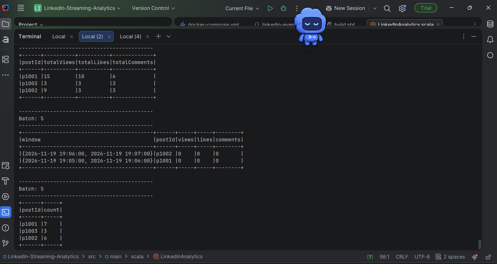
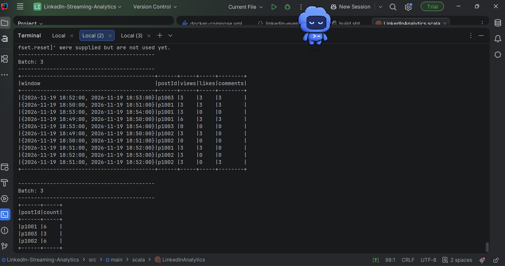

# LinkedIn Streaming Analytics

A Scala and Apache Spark Structured Streaming application that consumes LinkedIn-style interaction events from Kafka and reports per-post totals, unique members, and one-minute event-time windows.

## Requirements

- Java 17
- SBT 1.13.1
- Docker Desktop with Docker Compose

## Start Kafka

From this directory, start the Kafka broker and Kafka UI:

```powershell
docker compose -f docker\docker-compose.yml up -d
docker compose -f docker\docker-compose.yml exec kafka `
  /opt/kafka/bin/kafka-topics.sh `
  --bootstrap-server kafka:29092 `
  --create --if-not-exists --topic linkedin-events `
  --partitions 3 --replication-factor 1
```

Kafka UI is available at [http://localhost:8080](http://localhost:8080).

## Run the application

Start the Spark application from this directory:

```powershell
sbt run
```

The app connects to `localhost:9092` by default. Override `KAFKA_BOOTSTRAP_SERVERS` when using a different Kafka address.

In another terminal, send the sample events after the application has started:

```powershell
Get-Content data\linkedin-events.jsonl |
  docker compose -f docker\docker-compose.yml exec -T kafka `
    /opt/kafka/bin/kafka-console-producer.sh `
    --bootstrap-server kafka:29092 --topic linkedin-events
```

Spark prints each aggregation to the console. Checkpoint state is stored in `checkpoints/` and can be removed between fresh runs.

## Project structure

```text
.
├── build.sbt
├── data/linkedin-events.jsonl
├── docker/docker-compose.yml
├── outputs/
└── src/main/scala/LinkedInAnalytics.scala
```

## Sample output

The screenshots below show the per-post aggregates and windowed event counts from a successful run.




