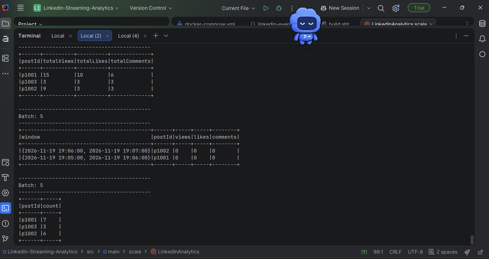
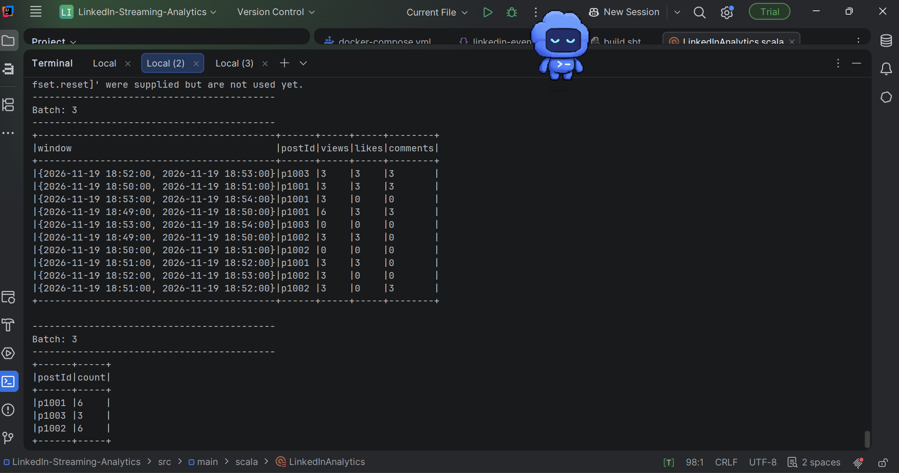
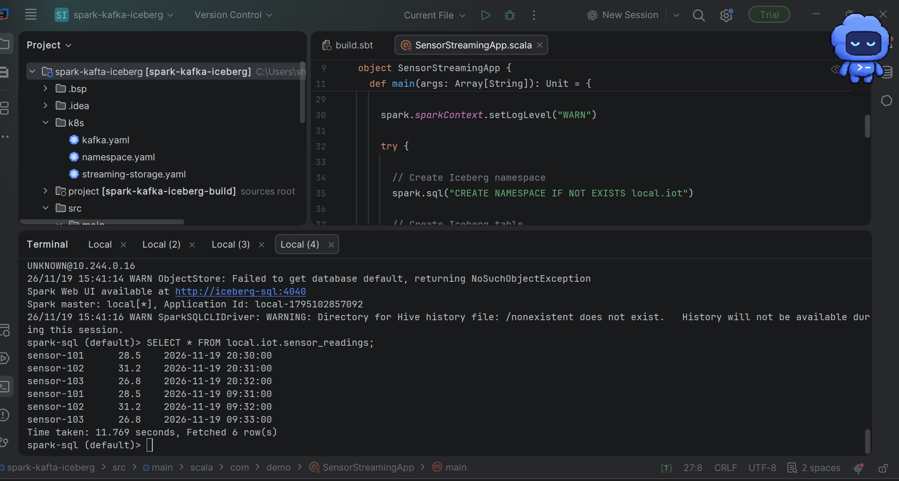

# Dell Upskilling Spark Projects

This repository contains several independent Scala and Apache Spark learning projects.

## Projects

- **Spark Typed Datasets** (repository root): demonstrates DataFrame and typed Dataset operations over employee data.
- **Employee Spark Analysis** ([`Employee_Spark-Scala3`](Employee_Spark-Scala3/)): employee analysis with reusable Spark DataFrame transformations and a captured sample output.
- **Spark Testing Capstone** ([`SparkTestingCapstone`](SparkTestingCapstone/)): a standalone Scala/Spark project with source code, tests, build configuration, and captured output in one folder. Its GitHub Actions workflow is at the repository-required root path, `.github/workflows/ci.yml`.
- **Spark Kafka to Iceberg Streaming** ([`SparkKafkaIcebergStreaming`](SparkKafkaIcebergStreaming/)): a Kubernetes Spark Structured Streaming application that consumes sensor JSON records from Kafka and writes them to an Apache Iceberg table.
- **LinkedIn Streaming Analytics** ([`LinkedIn-Streaming-Analytics`](LinkedIn-Streaming-Analytics/)): a Kafka and Spark Structured Streaming application that calculates post engagement, unique members, and event-time window metrics.

## LinkedIn Streaming Analytics

The [`LinkedIn-Streaming-Analytics`](LinkedIn-Streaming-Analytics/) folder contains the Scala application, sample Kafka events, Docker Compose configuration, and output screenshots. See its [README](LinkedIn-Streaming-Analytics/README.md) for setup and run instructions.

**Output screenshots:**





## Spark Kafka to Iceberg Streaming

The [`SparkKafkaIcebergStreaming`](SparkKafkaIcebergStreaming/) folder contains the complete Scala/Spark application, Docker and SBT configuration, Kubernetes manifests, and captured console output.

The application creates the `local.iot.sensor_readings` Iceberg table, reads JSON sensor events from the Kafka `sensor-data` topic, and appends valid records to the table.

See the [project README](SparkKafkaIcebergStreaming/README.md) for build, deployment, producer, Spark SQL verification, and cleanup instructions.

**Output screenshot:**



## Spark Testing Capstone

The batch pipeline validates required columns, filters invalid rows, normalizes text, derives totals and age groups, removes duplicate keys, and reports data-quality checks. Customer records can also be validated for required fields and a valid email address.

See the [capstone README](SparkTestingCapstone/README.md) for requirements and commands. To run it from the repository root:

```shell
cd SparkTestingCapstone
sbt run
sbt test
```

The sample run output is available at [`SparkTestingCapstone/outputs/sample-run-output.txt`](SparkTestingCapstone/outputs/sample-run-output.txt).

## Spark Typed Datasets

A small Scala application that demonstrates the difference between Spark DataFrames and strongly typed Datasets using employee data.

## What it demonstrates

- Filtering and sorting employees with a DataFrame
- Filtering and sorting typed `Dataset[Employee]` records
- Projecting records into a typed view
- Mapping employees into annual and monthly salary summaries

The sample data is defined in `TypedDatasetDemo` and runs locally with Spark's `local[*]` master.

## Requirements

- Java 17
- sbt 1.13.1 (the sbt launcher uses the version configured in `project/build.properties`)

Dependencies, including Apache Spark SQL 3.5.3, are resolved by sbt.

## Run

From the project directory:

```shell
sbt run
```

The application prints the results for each DataFrame and Dataset operation to the console.

## Project structure

```text
.
├── build.sbt
├── project/
└── src/main/scala/com/example/TypedDatasetDemo.scala
```

## Employee Spark Analysis

The [`Employee_Spark-Scala3`](Employee_Spark-Scala3/) folder contains a separate employee-analysis project with reusable Spark DataFrame transformations and a captured sample output.

See its [README](Employee_Spark-Scala3/README.md) for requirements and run instructions. The captured output is in [`Employee_Spark-Scala3/outputs/employee-analysis-output.txt`](Employee_Spark-Scala3/outputs/employee-analysis-output.txt).

## Spark Nested JSON Assignment

The [`SparkNestedJSONAssignment`](SparkNestedJSONAssignment/) folder contains the Scala/Spark assignment for reading and analyzing nested order JSON. It includes the sbt build files, the `orders.json` sample input, the Scala application, and captured output.

Requirements: Java 17 and sbt. To run it from the repository root:

```shell
cd SparkNestedJSONAssignment
sbt run
```

The captured run output is available at [`SparkNestedJSONAssignment/outputs/sample-run-output.txt`](SparkNestedJSONAssignment/outputs/sample-run-output.txt).
