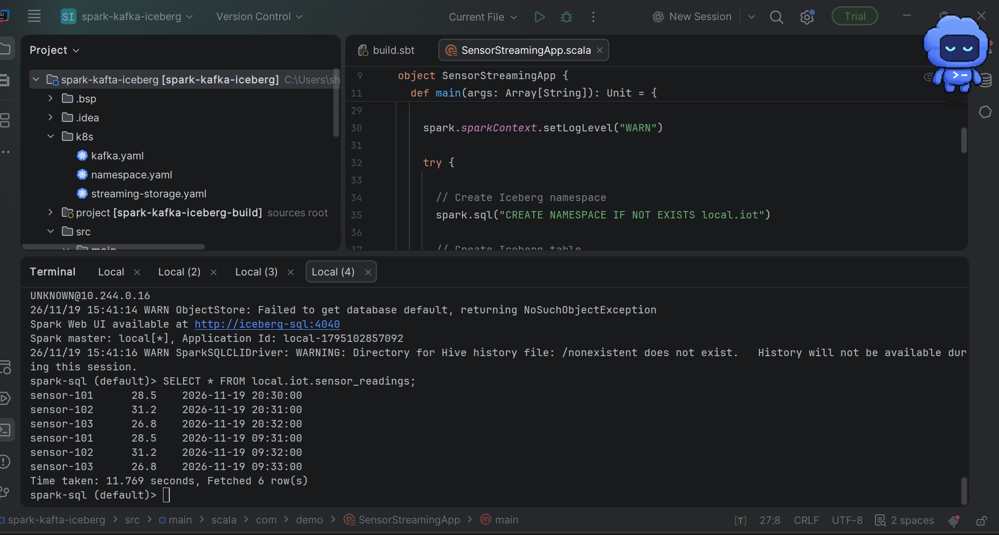

# Spark Kafka to Iceberg Streaming

This project demonstrates a Scala Spark Structured Streaming pipeline running on Kubernetes. It consumes JSON sensor records from Kafka and appends them to an Apache Iceberg table on a persistent local volume.

## Technology stack

- Scala 2.12
- Apache Spark 3.5.9
- Apache Iceberg 1.12.0
- Apache Kafka
- Kubernetes
- Docker
- SBT

## Project structure

```text
SparkKafkaIcebergStreaming/
├── build.sbt
├── Dockerfile
├── spark-rbac.yaml
├── k8s/
│   ├── kafka.yaml
│   ├── namespace.yaml
│   └── streaming-storage.yaml
├── src/main/scala/com/demo/SensorStreamingApp.scala
└── outputs/
    └── sensor-streaming-output.png
```

## Prerequisites

- Java 17
- SBT
- Docker Desktop with Kubernetes enabled
- `kubectl`
- Spark 3.5.9

Use the Docker Desktop Kubernetes context:

```powershell
kubectl config use-context docker-desktop
```

## Build

From this project folder:

```powershell
sbt clean assembly
docker build -t spark-kafka-iceberg:1.0 .
```

The application JAR is created at `target\scala-2.12\spark-kafka-iceberg.jar`.

## Deploy

Create the namespace and storage:

```powershell
kubectl apply -f k8s\namespace.yaml
kubectl apply -f k8s\streaming-storage.yaml
```

Deploy Kafka and the required Spark RBAC resources:

```powershell
kubectl apply -f k8s\kafka.yaml
kubectl apply -f spark-rbac.yaml
kubectl rollout status deployment/kafka -n streaming --timeout=180s

kubectl exec deployment/kafka -n streaming -- `
  /opt/kafka/bin/kafka-topics.sh `
  --bootstrap-server kafka:9092 `
  --create --if-not-exists --topic sensor-data `
  --partitions 3 --replication-factor 1
```

Start the Kubernetes API proxy:

```powershell
kubectl proxy
```

Submit the application in a separate terminal:

```powershell
spark-submit `
  --master k8s://http://127.0.0.1:8001 `
  --deploy-mode cluster `
  --name sensor-kafka-to-iceberg `
  --class com.demo.SensorStreamingApp `
  --conf spark.kubernetes.namespace=streaming `
  --conf spark.kubernetes.authenticate.driver.serviceAccountName=spark `
  --conf spark.kubernetes.container.image=aaryasree3010/spark-kafka-iceberg:1.0 `
  --conf spark.kubernetes.container.image.pullPolicy=IfNotPresent `
  --conf spark.executor.instances=1 `
  --conf spark.sql.shuffle.partitions=2 `
  --conf spark.kubernetes.driver.volumes.persistentVolumeClaim.data.options.claimName=streaming-data `
  --conf spark.kubernetes.driver.volumes.persistentVolumeClaim.data.mount.path=/data `
  --conf spark.kubernetes.executor.volumes.persistentVolumeClaim.data.options.claimName=streaming-data `
  --conf spark.kubernetes.executor.volumes.persistentVolumeClaim.data.mount.path=/data `
  local:///opt/spark-apps/spark-kafka-iceberg.jar
```

## Send sensor data

Open a Kafka producer:

```powershell
kubectl exec -it deployment/kafka -n streaming -- `
  /opt/kafka/bin/kafka-console-producer.sh `
  --bootstrap-server kafka:9092 --topic sensor-data
```

Send JSON records one at a time:

```json
{"deviceId":"sensor-101","temperature":31.2,"eventTime":"2026-11-19T09:31:00"}
{"deviceId":"sensor-103","temperature":26.8,"eventTime":"2026-11-19T09:33:00"}
```

## Verify the Iceberg table

Find the Spark driver pod and start Spark SQL:

```powershell
$driverPod = kubectl get pods -n streaming -o custom-columns=NAME:.metadata.name --no-headers |
  Where-Object { $_ -match '-driver$' } |
  Select-Object -First 1

kubectl exec -it $driverPod -n streaming -- `
  /opt/spark/bin/spark-sql `
  --jars /opt/spark-apps/spark-kafka-iceberg.jar `
  --conf spark.sql.extensions=org.apache.iceberg.spark.extensions.IcebergSparkSessionExtensions `
  --conf spark.sql.catalog.local=org.apache.iceberg.spark.SparkCatalog `
  --conf spark.sql.catalog.local.type=hadoop `
  --conf spark.sql.catalog.local.warehouse=file:///data/warehouse
```

Run:

```sql
SELECT * FROM local.iot.sensor_readings;
SELECT COUNT(*) FROM local.iot.sensor_readings;
QUIT;
```

## Output screenshot

The captured successful run shows sensor records stored in the `local.iot.sensor_readings` Iceberg table:



## Cleanup

```powershell
kubectl delete namespace streaming
```
